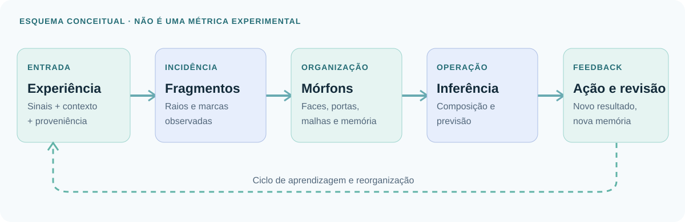
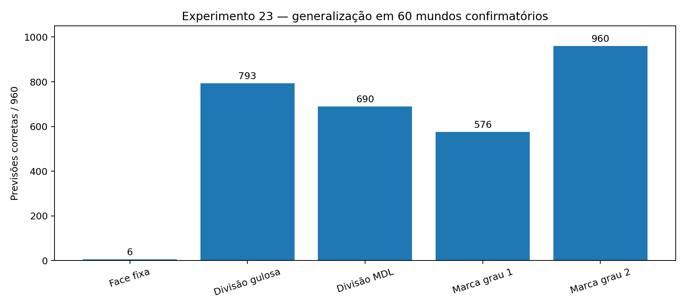
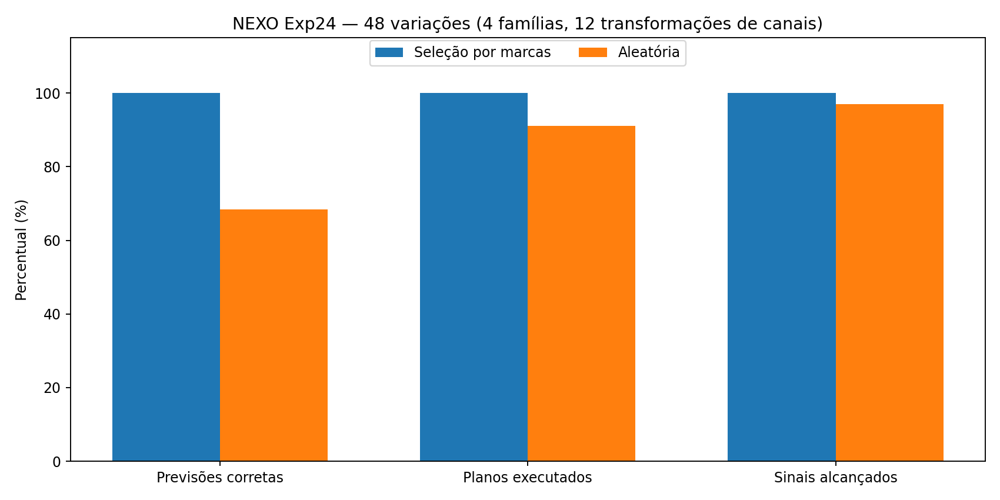
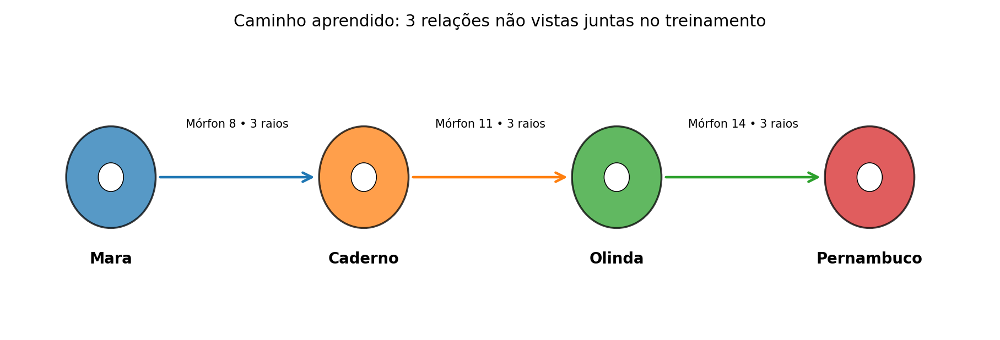
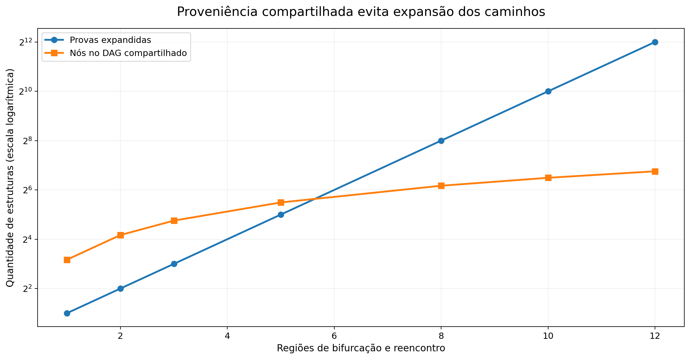

<div align="center">


# NEXO

**Arquitetura de memória relacional executável · Mórfons · Aprendizagem a partir da experiência**

[](https://doi.org/10.5281/zenodo.24094723)
[](https://www.python.org/)

[](LICENSE)
[](LICENSE-DOCS.md)

*Um programa experimental independente para investigar como a experiência pode construir memória, relações e funções executáveis sobre um mesmo substrato.*

</div>

## O que o NEXO já demonstrou

Os experimentos produziram **estruturas relacionais aprendidas, previsões sobre situações não ensinadas, composição de relações, persistência e revisão da memória, seleção informativa de experiências e efeitos causais mensuráveis de marcas, raios e portas**. Os números abaixo correspondem a protocolos e dados incluídos neste repositório.

| Demonstração | Evidência experimental | Código e dados |
|:---|:---|:---|
| **Composição relacional inédita** | **2.000/2.000** consultas corretas em 40 mundos novos; inclui **320** consultas de 2–3 saltos cujas composições completas não foram ensinadas. | [Exp. 17](experiments/17-raciocinio-contextual/) |
| **Transformação numérica aprendida** | **1.000/1.000** somas inéditas a partir de oito transições binárias aprendidas com demonstrações intermediárias, incluindo `17 + 26 = 43`. | [Exp. 17](experiments/17-raciocinio-contextual/) |
| **Aprendizagem durante o diálogo e persistência** | **384/384** consultas novas, **175/175** consultas sobre sete paráfrases ensinadas e restauração de sessão equivalente à execução contínua. | [Exp. 21](experiments/21-memoria-continua/) |
| **Funções nas faces com dependência causal** | **960/960** previsões inéditas e **962/962** objetivos no protocolo confirmatório; remover pulsos, faces ou marcas decisivas altera/bloqueia inferências. | [Exp. 23](experiments/23-faces-funcionais/) |
| **Ciclo integrado: aprender → prever → agir → revisar** | **480/480** previsões e **1.034/1.034** planos bem-sucedidos com experiências selecionadas por ganho informacional; controle aleatório: **328/480** previsões identificadas, **942/1.034** planos. | [Exp. 24](experiments/24-ciclo-integrado/) |
| **Generalização entre malhas, com contexto** | **600/600** casos sintéticos resolvidos conforme identidade e contexto; ablações sem contexto produzem **126** falsos positivos. | [Malhas](experiments/malhas-compartilhadas/) |
| **Proveniência fatorada** | **4.096** provas possíveis representadas por **108 nós DAG** e verificadas com apenas **48** exames relacionais no caso de 12 losangos. | [Malhas](experiments/malhas-compartilhadas/) |
| **Composição de quatro condições** | Acurácia balanceada **1,000** no mundo de quatro condições, ante **0,500** do comparador de alcance menor (Exp. 08). | [Exp. 14](experiments/14-morfon-integrado/) |

**Verificação atual:** as sete suítes originais foram reexecutadas em **10/11/2026**, com **115/115 testes aprovados**. O registro da reexecução está em [`reproducibility/`](reproducibility/) e pode ser renovado com `python scripts/test_all.py`. As métricas principais também são auditadas diretamente nos JSONs primários por `python scripts/verify_results.py`.

## Como funciona

O **Mórfon** é a unidade relacional do NEXO. Sua proposta combina um núcleo operacional estável, três vias de sinal (`−1`, `0`, `+1`), faces/fragmentos/portas mutáveis, raios de ativação, memória de contexto e proveniência. **Um raio é suficiente para ativar** uma unidade; incidências adicionais sustentam a ativação, sem representar automaticamente novas provas independentes. Mórfons Gênesis fornecem operações elementares de construção e reorganização; as organizações específicas são adquiridas e modificadas a partir de experiências.



A pesquisa desenvolve componentes **em experimentos distintos**, não uma versão monolítica em que todas as capacidades de todos os arquivos já estejam integradas. O Exp. 24 é a bateria integrada de percepção estruturada, função aprendida, previsão, ação, feedback e revisão numa mesma `MorphMemory`. A experiência de malhas é uma investigação matemática/Python complementar de compartilhamento, composição contextual e proveniência.

## Evidências ilustradas

| Generalização funcional · Exp. 23 | Aprendizagem e ações · Exp. 24 |
|:--:|:--:|
|  |  |

| Composição de Mórfons · Exp. 17 | Fatoração de proveniência · malhas |
|:--:|:--:|
|  |  |

Mais gráficos e seus dados estão dentro de cada experimento, preservados do pacote de origem.

## Executar

Requisitos: **Python 3.11+**. A maior parte dos testes usa exclusivamente a biblioteca padrão. O Exp. 14 e a geração opcional de gráficos usam bibliotecas científicas.

```bash
# Opcional para o Exp. 14 e visualizações
python -m pip install -r requirements-optional.txt

# Todas as suítes de regressão
python scripts/test_all.py

# Conferir as métricas dos resultados arquivados
python scripts/verify_results.py

# Conferir os hashes dos arquivos originais incluídos
python scripts/verify_source_hashes.py
```

Para reproduzir **baterias experimentais**, gráficos, avaliações e diálogos interativos, consulte [`docs/REPRODUCAO.md`](docs/REPRODUCAO.md), com comandos por experimento. A rotina de testes não reexecuta automaticamente todas as baterias de milhares de casos: ela verifica as suítes originais e os registros de resultados são auditados separadamente.

## Pesquisa e publicação

**Artigo de referência:**

> Rosa, L. (2026). *NEXO: Arquitetura de memória relacional executável — fundamentos, demonstrações e resultados experimentais com auditoria causal* (Version 1.0). Zenodo. [https://doi.org/10.5281/zenodo.24094723](https://doi.org/10.5281/zenodo.24094723)

Autor: **Luan Rosa Alves da Silva** · assinatura bibliográfica **Rosa, Luan** · [ORCID 0009-0000-2754-7135](https://orcid.org/0009-0000-2754-7135).

O artigo apresenta a arquitetura e sistematiza sua trajetória experimental; este repositório reúne código executável, dados, controles e material de reprodução de sete linhas selecionadas. As demonstrações numéricas indicadas aqui são relativas aos **ambientes e contratos de cada ensaio**, explicados em [`docs/RESULTADOS.md`](docs/RESULTADOS.md). Resultados adversariais, erros observados, abstenções e ablações são mantidos — não são apagados para melhorar métricas.

**Documentação:** [Arquitetura](docs/ARQUITETURA.md) · [Resultados e controles](docs/RESULTADOS.md) · [Reprodução](docs/REPRODUCAO.md) · [Proveniência dos arquivos](docs/PROVENIENCIA.md).

## Licenças

Código experimental e scripts novos: **MIT**, conforme [`LICENSE`](LICENSE). Documentação, figuras e textos originais: **Creative Commons Attribution 4.0 International (CC BY 4.0)**, conforme [`LICENSE-DOCS.md`](LICENSE-DOCS.md). Reutilização e distribuição são permitidas, inclusive comercialmente, respeitando a atribuição aplicável. Ver [`NOTICE.md`](NOTICE.md) para crédito e escopo.
