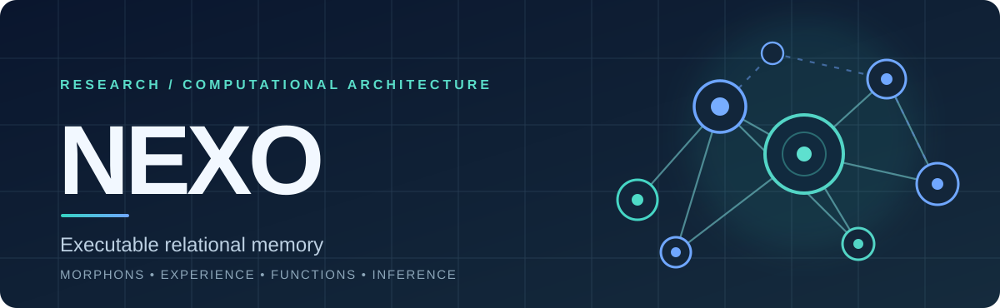
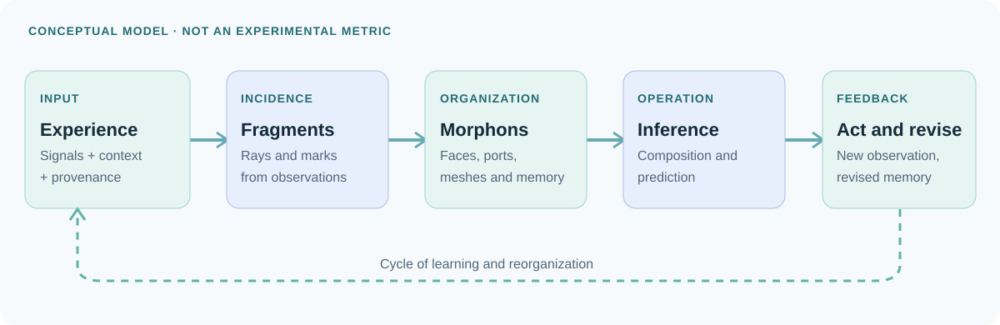
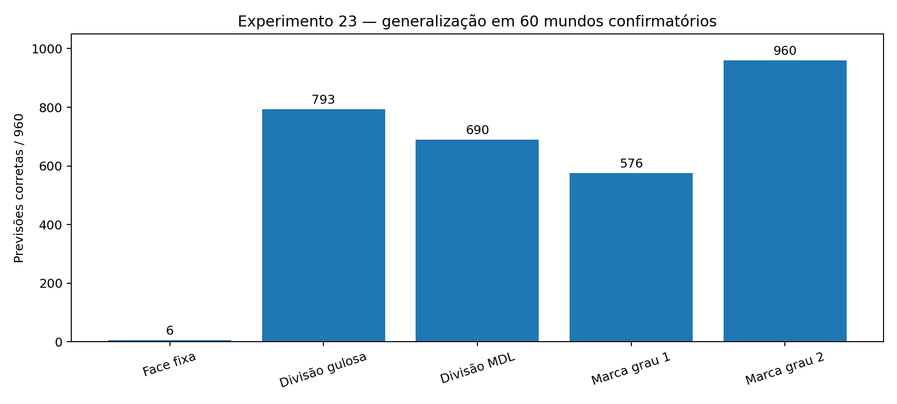
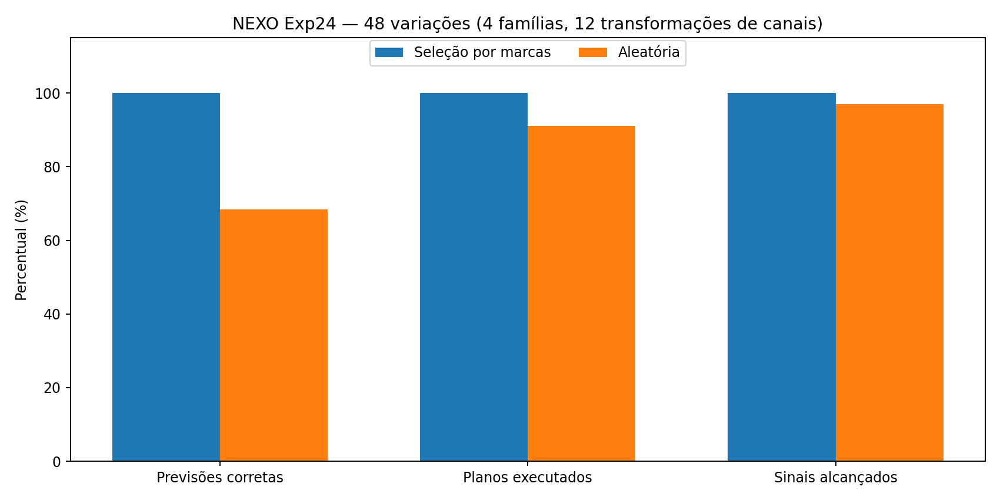
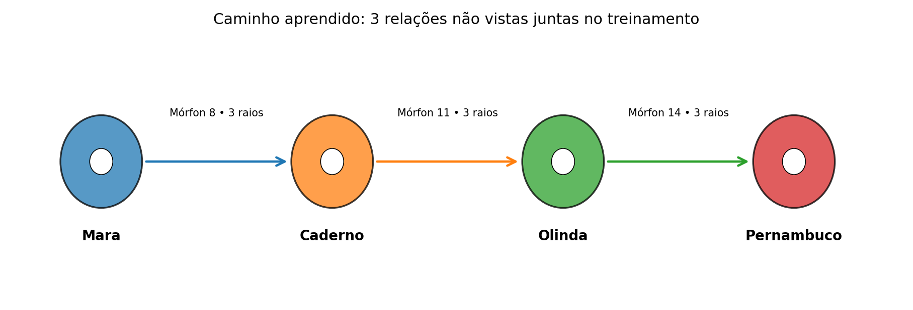
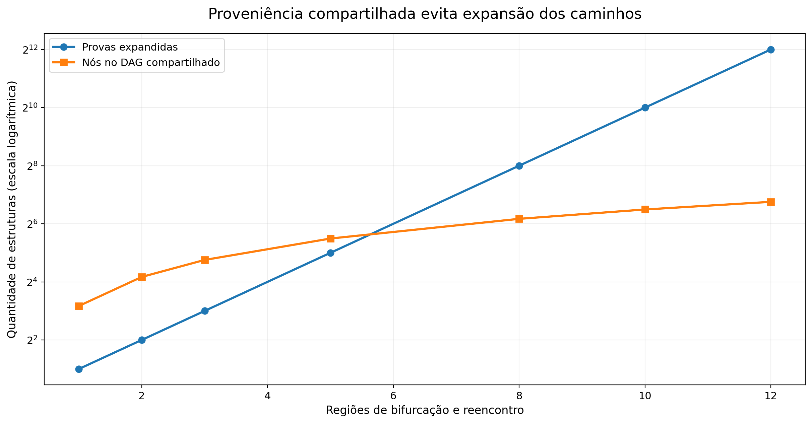

# NEXO
### Executable Relational Memory · A Computational Research Program

**Can a machine turn experience into memory that does more than remember — memory that can participate in computation?**

[**Explore the live Morphons AI demo**](https://morphons-ai.vercel.app/) · [**Research architecture**](docs/ARCHITECTURE.md) · [**Experimental evidence**](docs/RESULTS.md) · [**Reproduce**](docs/REPRODUCIBILITY.md)

**English** | [Português (Brasil)](README.pt-BR.md)

*Research by Luan Rosa · [ORCID 0009-0000-2754-7135](https://orcid.org/0009-0000-2754-7135)*

---

## At a glance

**NEXO** investigates a different way to organize computational intelligence: instead of treating experiences solely as records to retrieve, it studies how relationships acquired through experience can become **persistent, modifiable, and executable structures**.

The elementary unit is a **Morphon** (Portuguese: *Mórfon*). Morphons can hold surface fragments and interaction marks, connect through relational ports, receive activation signals, and participate in larger **relational meshes**. The associated **LIM — Large Interaction Memory** proposal explores learning, inference, and action through such organized memory.

This repository is a **research archive and reproducibility resource**, not the source tree of a single finished general-purpose AI. Its experimental branches address distinct mechanisms and retain their own source code, protocols, observations, failures, and controls.

<strong>What is the difference between NEXO, LIM and Morphons AI?</strong>

- **NEXO** is the broader research program and architectural investigation.
- **LIM (Large Interaction Memory)** is the proposed intelligence model centered on executable relational memory.
- **Morphons** are the fundamental units used by the proposed architecture.
- **[Morphons AI](https://morphons-ai.vercel.app/)** is a related, separately maintained interactive application. Its current implementation is not identical to every historical experiment in this repository; the published experiment results below belong to their archived protocols.

## The idea: memory as a computational substrate

A Morphon is modeled as an **invariant operational core** with three signal states/paths (−1, 0, +1), plus **modifiable faces, fragments, marks, ports, and relational configurations**. The proposed Genesis Morphons provide initial elementary capabilities for creating, copying, modifying, and removing these organizations. Learning does not require rewriting the core: it changes the structures through which the core operates.

An incoming ray may activate a Morphon; receiving multiple rays adds support or context, not automatically independent evidence. Crucially, **activation and the satisfaction of conditions for emission are distinct operations**. Relationships can therefore participate in conditional execution, inhibition, composition, prediction and revision.

The research cycle is:

**Experience → representation → local activation → regularity discovery → functional organization → inference/action → new experience → revision**

The architecture is developed through laboratory implementations that test particular portions of this cycle. Read the [architecture notes](docs/ARCHITECTURE.md) for the technical model, the [research guide](docs/RESEARCH_GUIDE.md) for an accessible walkthrough, and the [original Portuguese architecture notes](docs/ARQUITETURA.md) for the prior formulation.

## What has actually been tested?

The figures below are **recorded results from specific experimental protocols**, not pooled scores for one system. A complete audit trail, controls, source paths and interpretation appear in [Results & controls](docs/RESULTS.md).

| Research direction | Recorded result | Inspect |
| :-- | :-- | :-- |
| **Structural learning · Exp. 08** | Formation, promotion, persistence and removal of organizations from binary experiences; 8 regression tests | [Experiment 08](experiments/08-aprendizagem-esferas/) |
| **Integrated substrate · Exp. 14** | Balanced accuracy **1.000** versus **0.500** for a smaller-reach comparator in the four-condition world | [Experiment 14](experiments/14-morfon-integrado/) |
| **Relational composition · Exp. 17** | **2,000/2,000** held-out queries across 40 new worlds, including **320** previously undemonstrated multi-hop compositions | [Experiment 17](experiments/17-raciocinio-contextual/) |
| **Learned binary transitions · Exp. 17** | **1,000/1,000** unseen additions using eight taught binary transitions and intermediate states | [Experiment 17](experiments/17-raciocinio-contextual/) |
| **Persistent dialogue memory · Exp. 21** | **384/384** new observation queries and **175/175** queries after incremental paraphrase teaching | [Experiment 21](experiments/21-memoria-continua/) |
| **Functional surface marks · Exp. 23** | **960/960** held-out predictions; **962/962** targets; causal interventions on active marks and pulses | [Experiment 23](experiments/23-faces-funcionais/) |
| **Learning–prediction–action loop · Exp. 24** | **480/480** identified predictions and **1,034/1,034** plans; random-experience control: **328/480** and **942/1,034** | [Experiment 24](experiments/24-ciclo-integrado/) |
| **Shared relational meshes** | **600/600** synthetic classifications with compatible identity/context; **126** false positives when context was ignored | [Mesh study](experiments/malhas-compartilhadas/) |
| **Factorized provenance** | **4,096** possible paths represented by a **108-node DAG** in the 12-diamond example | [Mesh study](experiments/malhas-compartilhadas/) |

| Functional marks · Experiment 23 | Learning and action · Experiment 24 |
| :--: | :--: |
|  |  |

| Contextual composition · Experiment 17 | Shared meshes and proof provenance |
| :--: | :--: |
|  |  |

### How to interpret the evidence

The environments are mainly **controlled synthetic worlds** with explicit train/test separation. Depending on the experiment, evaluation includes unseen worlds, comparative baselines, ablations, adversarial cases, abstentions and restoration checks. Some branches use structured linguistic supervision; Experiments 23–24 learn world-specific patterns within a selected GF(2) function family, while generic algebraic operations and planning mechanisms are implemented in code.

This distinction is part of the science: **learning the parameters or relations of a world is not the same claim as inventing the computational operators themselves**. Experiment 21 also documents a historical retrieval path that depended partly on external indices; physical causal claims about ports and marks are supported more directly by interventions in Experiments 23–24. [Read the full evidence inventory](docs/RESULTS.md).

## Explore the research

| Start here | What you will find |
| :-- | :-- |
| [Research guide](docs/RESEARCH_GUIDE.md) | A readable introduction, a conceptual example, a glossary, and the boundary between hypotheses and results |
| [Architecture](docs/ARCHITECTURE.md) | Morphon core, surfaces, ports, rays, Genesis organization and mesh identity |
| [Results & controls](docs/RESULTS.md) | Protocol-by-protocol metrics, comparisons, interventions and archived evidence |
| [Experiment directory](experiments/README.md) | A guided map to the seven archived suites and the separate V4.0 investigation |
| [Reproducibility](docs/REPRODUCIBILITY.md) | Commands, environment, integrity verification and safe re-execution |
| [Provenance & integrity](docs/PROVENANCE.md) | Original source archives, SHA-256 inventory and preservation policy |
| [Portuguese documentation](docs/README.pt-BR.md) | Navegação pelos documentos e relatórios em português |

### Try the related interactive system

**[Open Morphons AI — live browser application](https://morphons-ai.vercel.app/)**

Morphons AI is a companion implementation developed from the same research direction. It has its **own codebase, model snapshot, training and deployment lifecycle**. The archived NEXO experiments here are the correct source for the experimental figures above; the web application is for interacting with a related evolving system.

## Reproduce the archive

**Requirements:** Python 3.11+; an ordinary local environment. Most tests use the Python standard library. Install optional scientific dependencies for the Experiment 14 suite.

~~~bash
git clone https://github.com/luannsr12/morfons-nexo.git
cd morfons-nexo

python -m pip install -r requirements-optional.txt

# Independently exercise the archived suites
python scripts/test_all.py --no-save

# Check the recorded result files
python scripts/verify_results.py

# Check the original experiment files against archived SHA-256 values
python scripts/verify_source_hashes.py
~~~

The [November 10, 2026 retest record](reproducibility/retest_2026-11-10.json) reports **115/115 regression tests passed** across the seven suites. The [CI workflow](.github/workflows/tests.yml) also runs these checks. Rerun the longer benchmarks in a separate working copy because some experiment scripts overwrite files in their own results folders. Full instructions are in [Reproducibility](docs/REPRODUCIBILITY.md).

## Papers and citation

**Primary reference**

> Rosa, L. (2026). *NEXO: Arquitetura de memória relacional executável — fundamentos, demonstrações e resultados experimentais com auditoria causal* (Version 1.0). Zenodo. https://doi.org/10.5281/zenodo.24094723

**Companion publication:** [Zenodo DOI 10.5281/zenodo.24141657](https://doi.org/10.5281/zenodo.24141657).

**Author:** Luan Rosa Alves da Silva · bibliographic signature: **Luan Rosa** · [ORCID](https://orcid.org/0009-0000-2754-7135).

GitHub's *Cite this repository* feature uses [CITATION.cff](CITATION.cff). To cite a particular experimental finding, cite the relevant publication **and identify the experiment, protocol and source file**.

## License, openness and attribution

- **Experimental code and scripts:** [MIT License](LICENSE).
- **Original research writing, figures and datasets:** [CC BY 4.0](LICENSE-DOCS.md).
- **Credits, AI assistance and source provenance:** [NOTICE](NOTICE.md).
- **How to report a reproducibility issue:** [CONTRIBUTING](CONTRIBUTING.md).

The experiments have been preserved as research records, not silently rewritten to match a later product version. Questions, replications and critical examination of the methods are welcome.

**Executable memory · Relational structure · Learning from experience**

[Back to top](#nexo) · [Live Morphons AI demo](https://morphons-ai.vercel.app/) · [Português (Brasil)](README.pt-BR.md)

